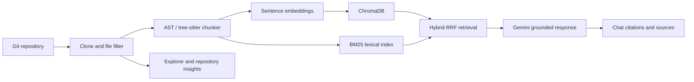

# RepoLens

RepoLens is a local-first Streamlit application for indexing Git repositories and asking Gemini questions grounded in retrieved source code. It combines syntax-aware chunking, local sentence embeddings, ChromaDB persistence, and BM25/vector hybrid search.

## Screenshots

Screenshots are not bundled with the source distribution. The app presents the Chat, Explorer, and Insights tabs in a wide, dark developer workspace.

## Requirements

- Python 3.10 to 3.12
- Git available on `PATH`
- A Gemini API key for chat, follow-up suggestions, and repository overviews

## Setup

```powershell
python -m venv .venv
.\.venv\Scripts\Activate.ps1
pip install -r requirements.txt
Copy-Item .env.example .env
```

Add your Gemini API key to `.env`, then start the app:

```powershell
streamlit run app.py
```

The first index may download the selected sentence-transformer model. Repository snapshots and Chroma indexes are stored locally in `data/`; do not commit this directory or `.env`.

## Architecture



- `app.py`: Streamlit page flow, indexing lifecycle, chat, and tabs.
- `core/ingest.py`: temporary clone, source filtering, language detection, and source snapshots.
- `core/chunker.py`: Python AST chunks, tree-sitter chunks for other languages, and line fallback.
- `core/indexer.py`: embeddings and persistent Chroma collections.
- `core/retriever.py`: BM25/vector fusion using reciprocal-rank fusion.
- `core/llm.py`: Gemini context-only prompts, streaming, and transient retries.
- `core/insights.py`: repository statistics and import diagrams.
- `ui/`: shared styling and display components.

## Design decisions

Code-aware chunks retain function/class boundaries and line coordinates, which makes retrieved evidence easier to inspect and cite than fixed-size fragments alone. A line-based fallback keeps malformed or unsupported files searchable. Hybrid retrieval combines semantic vector matches with exact lexical matches; reciprocal-rank fusion balances their different score scales without requiring score calibration.

The app sends only retrieved source chunks to Gemini for a chat answer and instructs the model to cite every factual claim. Embeddings and Chroma indexes run locally. Private repository tokens are supplied to Git through a temporary process environment header and are not stored in the registry.

## Limitations

- The Gemini API is required for generated answers, follow-ups, and overviews; usage is subject to Google's quota and privacy terms.
- Embedding models are downloaded from Hugging Face on first use. Large repositories can consume significant disk space and memory.
- The overview and import graph are heuristic; dynamic imports and runtime wiring may not be visible.
- Rendering the Mermaid diagram uses the browser's access to jsDelivr; the diagram falls back to source text if rendering is unavailable.
- Tree-sitter support depends on the grammars available in the pinned language pack. Unsupported formats use line-based chunks.
- This is a single-user local application; it does not provide authentication or multi-user access controls.

## Tests

```powershell
pytest -q
```
